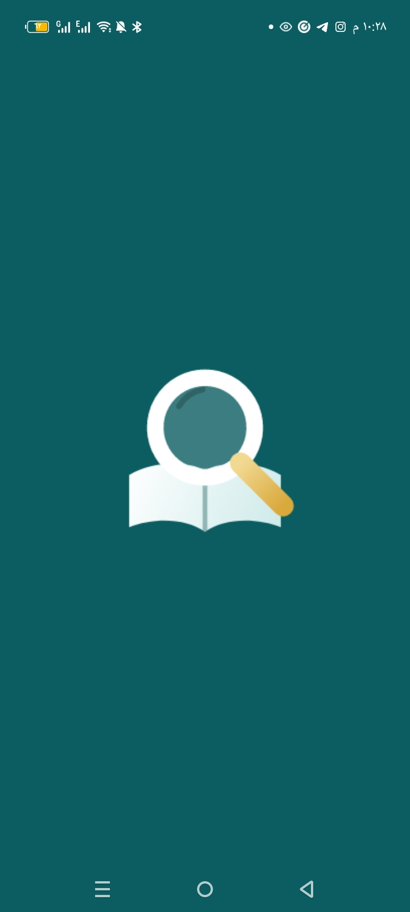
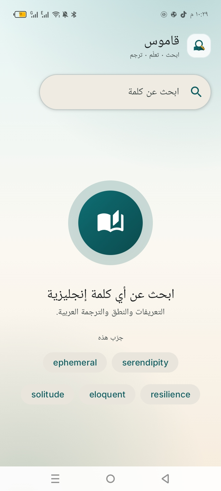
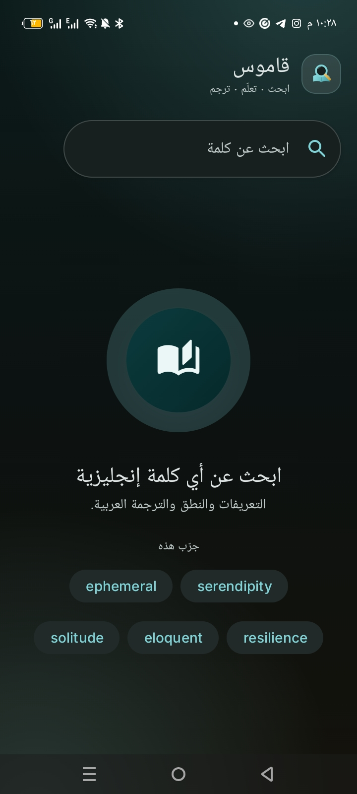
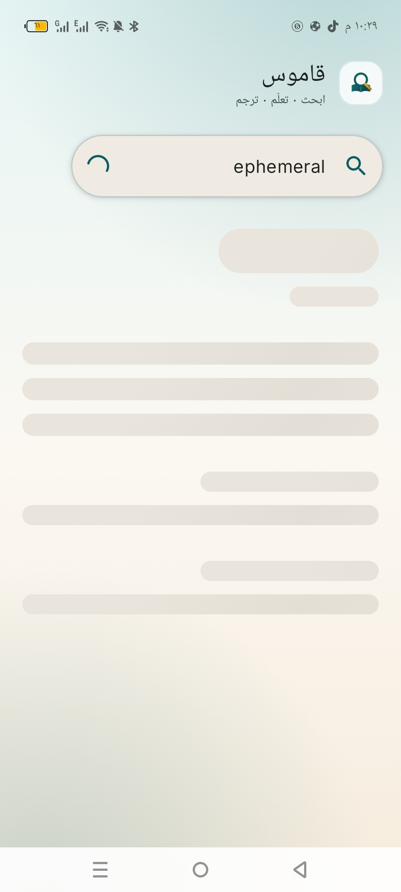
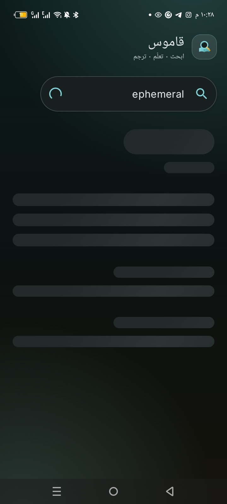
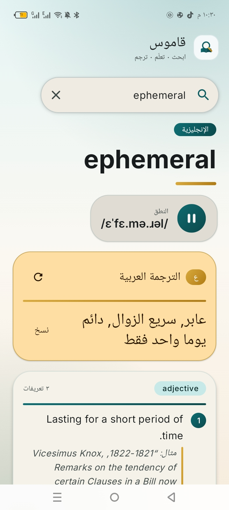
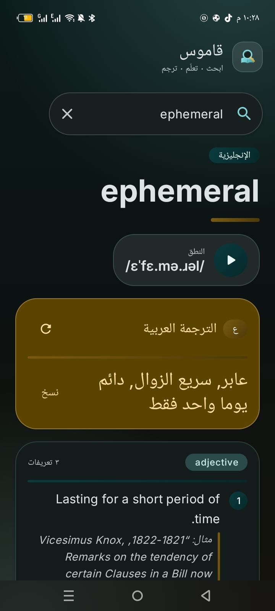
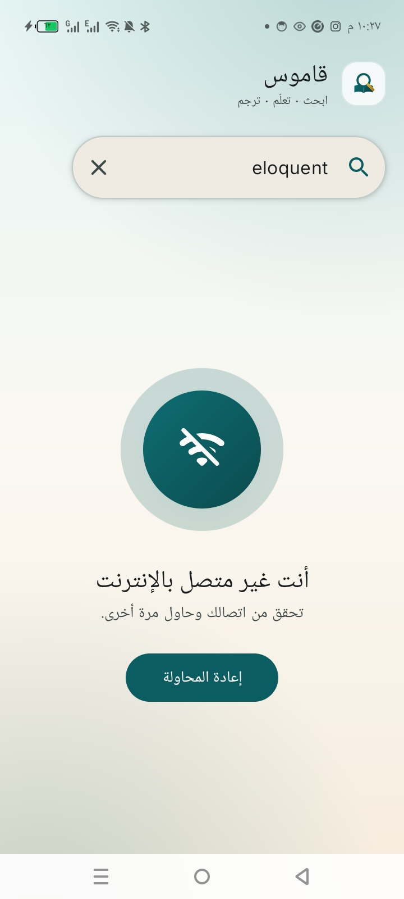
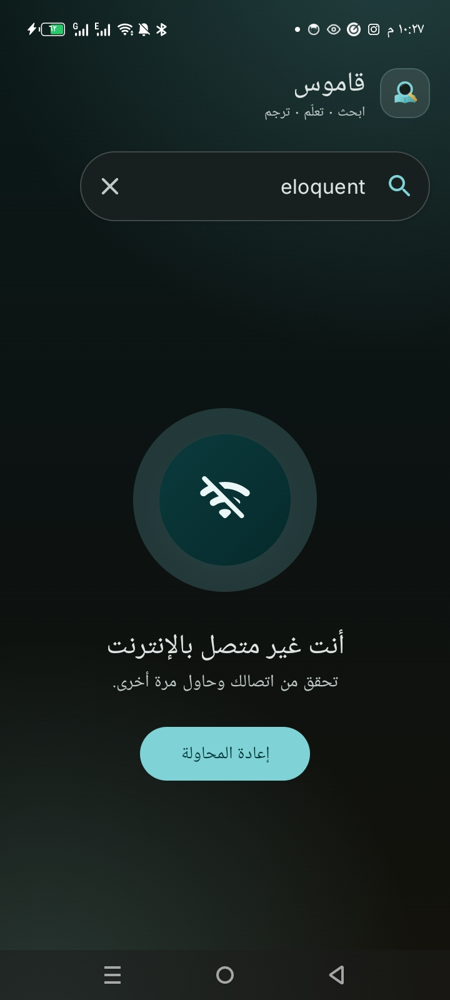

<!-- ════════════════════════════════════════════════════════════════════════ -->
<!--                              HERO                                        -->
<!-- ════════════════════════════════════════════════════════════════════════ -->

<p align="center">
  
</p>

<p align="center">
  <a href="https://developer.android.com"></a>
  <a href="https://kotlinlang.org"></a>
  <a href="https://developer.android.com/jetpack/compose"></a>
  <a href="https://m3.material.io"></a>
  <a href="#architecture"></a>
</p>

<p align="center">
  
  
  
  
  
</p>

<p align="center">
  <i>Look up any English word — definitions, phonetic transcription, pronunciation audio<br/>
  and Arabic translation, wrapped in a polished light &amp; dark interface.</i>
</p>

<p align="center">
  
  
  
  
  
</p>

---

## 📑 Contents

- [About](#about)
- [Features](#features)
- [Design & Palette](#design)
- [Screenshots](#screenshots)
- [Tech Stack](#tech-stack)
- [Architecture](#architecture)
- [APIs & Attribution](#apis)
- [Project Structure](#structure)
- [Getting Started](#getting-started)
- [Testing](#testing)
- [Roadmap](#roadmap)
- [Credits](#credits)

<a name="about"></a>

## 📖 About

**Dictionary** is a clean, modern Android app for looking up any English word. Type
a word and instantly get its definitions grouped by part of speech, example
sentences, IPA phonetic transcription, pronunciation audio, and an **Arabic
translation** — all wrapped in a polished, branded light &amp; dark interface.

> **Look up · Learn · Translate.**

Built with **Kotlin** and **Jetpack Compose**, following a clean
`data / domain / presentation` structure with an **MVI** presentation layer and
**Hilt** for dependency injection.

<a name="features"></a>

## ✨ Features

**🔍 Lookup**
- Instant definitions grouped by part of speech, each with usage examples.
- IPA phonetic transcription for the word.
- A curated list of suggested words on the idle screen.

**🔊 Pronunciation**
- Plays the recorded audio when the API provides it.
- Falls back to the device **Text-to-Speech** engine when a word has no audio file.
- Animated play / pause control with loading feedback.

**🌍 Arabic Translation**
- English → Arabic translation of the searched word.
- RTL-aware typography with copy-to-clipboard.

**🎨 Design**
- A refined **teal &amp; gold** palette with complete light and dark schemes.
- Custom vector logo, adaptive + monochrome launcher icon and a themed splash.
- Animated shimmer loading skeleton and friendly, on-brand state screens.

**🛡 Reliability**
- Queries a primary dictionary API and **automatically falls back** to a secondary
  provider when needed.
- Typed `Result<Success, Error>` — no exceptions leak into the UI.
- Dedicated offline, not-found and server-error states.

**🌐 Localization** — English and Arabic, with full RTL support.

<a name="design"></a>

## 🎨 Design & Palette

An editorial *"paper &amp; ink"* identity: deep teal for structure, warm paper
surfaces, and gold reserved as the translation accent.

| Swatch | Color | Hex | Role |
| :---: | --- | --- | --- |
|  | **Teal Ink** | `#0B5D61` | Primary — brand &amp; structure |
|  | **Hero Teal** | `#0E6E73` | Hero gradients &amp; accents |
|  | **Gold** | `#D9A93C` | Translation accent &amp; highlight |
|  | **Paper** | `#FBF8F2` | Light surface |
|  | **Ink** | `#0C1211` | Dark surface |

**Typography** — **Inter** (variable) for Latin, **Noto Sans Arabic** for Arabic
body text and elegant **Noto Naskh Arabic** for Arabic display, wired into a
Material 3 type scale.

**Theming** — Material 3 color scheme with light &amp; dark tokens, edge-to-edge
layout with status-bar integration, and no dynamic color, so the brand stays
consistent on every device.

<a name="screenshots"></a>

## 📱 Screenshots

The app ships with full light and dark themes.

<p align="center">
  
  <br/>
  <b>Splash</b>
</p>

| Screen | Light | Dark |
| --- | --- | --- |
| **Home &amp; Search** |  |  |
| **Loading** |  |  |
| **Word Detail** |  |  |
| **No Internet** |  |  |

<a name="tech-stack"></a>

## 🛠 Tech Stack

<p>
  
  
  
  
  
  
  
</p>

| Area | Technology |
| --- | --- |
| Language | Kotlin 2.1.21 |
| UI | Jetpack Compose (Material 3), Compose BOM 2024.09.00 |
| Architecture | Clean layers + MVI (Action / State / ViewModel) |
| DI | Hilt (Dagger) 2.56.2 |
| Networking | Retrofit 3.0.0 + Gson + OkHttp logging interceptor |
| Async | Kotlin Coroutines &amp; Flow |
| Splash | AndroidX Core SplashScreen |
| Icons | Material Icons Extended |
| Build | Android Gradle Plugin 8.9.2 · Gradle Kotlin DSL · Version Catalog |
| SDKs | min 26 · target 35 · compile 36 |

<a name="architecture"></a>

## 🏛 Architecture

A single feature module split into three layers with a unidirectional MVI flow:

```
UI (Compose)  ──Action──►  ViewModel  ──State (StateFlow)──►  UI
                                  │
                                  └──►  Repositories  ──►  Remote APIs
```

```
feature/my_dictionary
├── data          → Remote data sources (Retrofit APIs + DTOs), mappers, repositories, utilities
├── domain        → Pure Kotlin models (Word, Meaning, Definition, Translation) and the player contract
└── presantation  → Compose screen, components, state, actions and ViewModel (MVI)
```

- **Data layer** — Retrofit services for the dictionary, fallback and translation
  providers, DTO → domain mappers, and repositories that wrap results in a
  `Result<Success, Error>` type and handle the provider **fallback** logic.
- **Domain layer** — framework-independent models and the `PronunciationPlayer`
  abstraction.
- **Presentation layer** — an MVI `DictionaryScreenViewModel` exposing an immutable
  `DictionaryScreenState` `StateFlow` and a `UiAction` event stream, rendered by a
  single Compose screen composed of small, reusable components.

Dependency injection is configured with Hilt modules: `DictionaryModule`,
`TranslationModule` and `PlayerModule`.

<a name="apis"></a>

## 🔌 APIs & Attribution

| Purpose | Service | Notes |
| --- | --- | --- |
| Definitions (primary) | [dictionaryapi.dev](https://dictionaryapi.dev/) | Free Dictionary API |
| Definitions (fallback) | [freedictionaryapi.com](https://freedictionaryapi.com/) | Data licensed under **CC BY-SA 4.0** |
| Translation | [MyMemory](https://mymemory.translated.net/) | English → Arabic |
| Pronunciation | Device **Text-to-Speech** | Used when no audio file is available |

Thanks to the maintainers of these free services.

<a name="structure"></a>

## 📂 Project Structure

```
app/src/main/java/com/mohammed/dictionary
├── DictionaryApp.kt                 # Hilt application
├── MainActivity.kt                  # Single activity, edge-to-edge Compose host
├── feature/my_dictionary
│   ├── data
│   │   ├── data_source/remote/…      # Dictionary / fallback / translation APIs + DTOs
│   │   ├── data_source/player/…      # AndroidPronunciationPlayer (MediaPlayer + TTS)
│   │   ├── mappers/…                 # DTO → domain mappers
│   │   ├── repository/…              # Dictionary & translation repositories
│   │   └── util/…                    # Result, Error, text sanitizer
│   ├── di/…                          # Hilt modules
│   ├── domain
│   │   ├── model/…                   # Word, Meaning, Definition, Translation
│   │   └── player/…                  # PronunciationPlayer contract
│   └── presantation/dictionary_screen
│       ├── DictionaryScreen.kt       # Compose UI
│       ├── DictionaryScreenState.kt  # UI state
│       ├── DictionaryScreenAction.kt # User intents
│       ├── DictionaryScreenViewModel.kt
│       └── components/…              # Search bar, cards, state views, etc.
└── ui/theme/…                        # Color, typography, font family, shape, dimens, theme
```

<a name="getting-started"></a>

## 🚀 Getting Started

**Requirements**

- Android Studio (latest stable)
- JDK 17 or newer
- Android SDK 36

**Build &amp; run**

```bash
# Clone the repository
git clone https://github.com/mohammed-amin20/Dictionary.git

# Build the debug APK
./gradlew :app:assembleDebug

# Install on a connected device / emulator
./gradlew :app:installDebug
```

On Windows, use `gradlew.bat` instead of `./gradlew`. You can also open the
project in Android Studio and press **Run**.

<a name="testing"></a>

## 🧪 Testing

Unit tests cover the data mappers and the dictionary repository, including the
provider fallback behavior:

```bash
./gradlew :app:testDebugUnitTest
```

<a name="roadmap"></a>

## 🗺 Roadmap

- [ ] Save favourite words and lookup history
- [ ] Offline cache for recent lookups
- [ ] Synonyms &amp; antonyms from the dictionary data
- [ ] Selectable Text-to-Speech voices / accents
- [ ] Share or copy a word card
- [ ] More translation languages
- [ ] Home-screen widget

<a name="credits"></a>

## 🙌 Credits

- **Dictionary data** — [Free Dictionary API](https://dictionaryapi.dev/) and
  [freedictionaryapi.com](https://freedictionaryapi.com/) (CC BY-SA 4.0).
- **Translation** — [MyMemory](https://mymemory.translated.net/).
- **Fonts** — [Inter](https://github.com/rsms/inter) and
  [Noto Sans / Naskh Arabic](https://fonts.google.com/noto), licensed under the
  SIL Open Font License.
- **Built with** Kotlin &amp; Jetpack Compose — with thanks to their communities.

---

<div align="center">

**Dictionary** — Look up · Learn · Translate

⭐ If you find this project useful, consider giving it a star!

</div>
